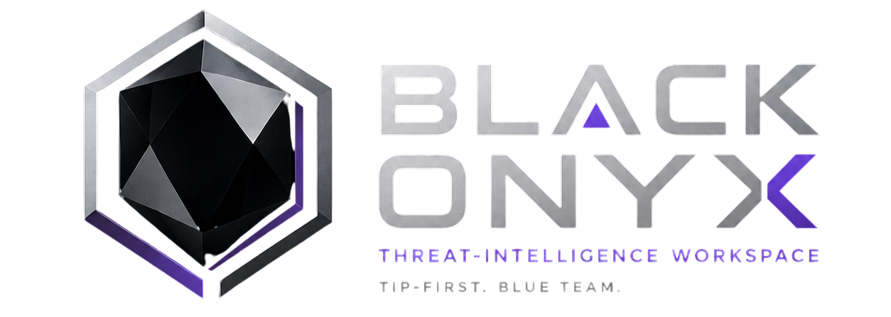

# Black Onyx - WIP



Black Onyx is a **threat-intelligence workspace** for blue-team investigation, integrated with a Kafka/Postgres detection platform for anomaly analysis, incidents, hunt, and response orchestration. It is not a SIEM replacement: it helps analysts ingest evidence, work IOCs, triage alerts and connector detections, correlate multi-model findings into incidents, manage cases and assets, and measure operational CTI impact with a secured React UI, versioned FastAPI API, SQLite TIP state, Postgres detection state, and Qdrant vector search.

Black Onyx was created by **Albert Clownstein**.

Documentation: [docs/README.md](docs/README.md)

- [Features](docs/FEATURES.md)
- [API](docs/API.md)
- [Configuration](docs/CONFIGURATION.md)
- [Deployment](docs/DEPLOYMENT.md)
- [Development](docs/DEVELOPMENT.md)
- [Security](docs/SECURITY.md)
- [Detection platform](docs/DETECTION_PLATFORM.md)
- [AI usage](docs/AI.md)
- [Models](MODELS.md)
- [Black Onyx 5B](docs/BLACK_ONYX_5B_INTEGRATION.md)
- [Brand](docs/brand/README.md)

## Models

- https://huggingface.co/Clownstein/Black-Onyx-5B
- https://huggingface.co/Clownstein/Black-Onyx-5B-GGUF


## What you can do

| Area | Capabilities |
|---|---|
| Evidence | Bounded uploads, admin-scoped directory ingest, OCR/CLIP images, semantic and image search, collections with annotations |
| Investigation | RAG chat, KQL/SPL-style **Query**, entity **Graph**, cases with timelines and MISP publish |
| Intelligence | IOC extract/enrich/score, STIX export, ATT&CK heatmap (risk-weighted, not vanity 100% coverage), Sigma/YARA generate and store, reports |
| Operations | Unified **Triage**, watchlists/alerts, SIEM/EDR **connectors**, streaming **detection** (ingest→Kafka→findings→incidents), hunt, SOAR response queue, playbooks, TAXII/MISP publishing, asset CMDB/posture, security profiles, malware lab orchestration |
| Security Lab | 45 cataloged defensive MCP tools (scanners, binary RE, crypto/DFIR, Web3); the enabled subset depends on tool gates, image attestation, and enforced egress; non-read actions use server-issued approval |
| Analytics | Disposition-aware MTTA/MTTR/FPR, alert/detection timeseries, intel age, enrichment coverage, fresh vs stale IOCs, connector health, detection data-health, saved views |
| Continuity | Admin **backup/restore** of SQLite state plus Qdrant snapshots (create, download, upload, restore) |
| Workspace UX | Immersive **Gallery** hub at `/`, classic shell for workflow pages, Black Onyx brand theme (violet/silver on `#0B0B0E`, Sora + IBM Plex Sans), light/dark + accent swatches |

## System requirements

Figures were measured on Docker Desktop (WSL2, Windows) with a 28-core host,
64 GB RAM, and one NVIDIA RTX 4060 Ti (16 GB VRAM), the reference GPU. Container RAM is `docker stats` RSS at idle after startup; GPU VRAM is
measured as the delta in `nvidia-smi` free memory with each model loaded alone,
since Docker Desktop's WSL2 GPU passthrough does not expose per-process VRAM.
Numbers below are per-tier so you can size for the pieces you actually run.

### Base stack: TIP only (`docker-compose.yml`: web + Qdrant + SearXNG)

No GPU required; embedding/CLIP/NER models (`device: "auto"`) fall back to CPU
automatically when none is present.

| | Minimum | Recommended |
| --- | --- | --- |
| CPU | 2 cores | 4 cores |
| RAM | 6 GB | 16 GB |
| Disk | 20 GB free | 40 GB free |
| GPU | none | none (optional: any CUDA GPU speeds up embedding/CLIP/OCR) |

Measured idle RSS: `web` 2.2 GB, `qdrant` 0.5–0.7 GB, `searxng` ~0.1 GB (≈3 GB
total). The minimum leaves headroom for Docker Desktop/WSL2 itself and for
Qdrant collections to grow; the recommended figure is comfortable for daily
ingest and search without swapping.

### Security tools stack: adds the LLM backends (`docker-compose.security-tools.yml`)

Requires an NVIDIA GPU with the NVIDIA Container Toolkit. Three models can run
concurrently: Black-Onyx-5B (`llama-server`, required for chat and the security
agent), Antares-1B (`vllm-antares`, vulnerability localization), and the
optional FunctionGemma 270M tool router.

| | Minimum | Recommended |
| --- | --- | --- |
| CPU | 4 cores | 8 cores |
| RAM | 8 GB | 16 GB |
| Disk | 50 GB free (images + model weights) | 80 GB free |
| GPU VRAM | **16 GB** | 24 GB |

Measured VRAM per model, loaded alone (Docker Desktop WSL2 passthrough cannot
attribute VRAM per-process, so each was measured as the delta with only that
model running):

| Model | VRAM | RAM (container) |
| --- | --- | --- |
| Black-Onyx-5B (Q8_0, 32K ctx, full GPU offload) | 3.97 GB | 0.7–4 GB |
| Antares-1B (vLLM, 16K ctx; see `docker-compose.security-tools.yml`) | 5.88 GB | 2.8–3 GB |
| FunctionGemma 270M tool router (optional) | 0.51 GB | 0.3–0.5 GB |

All three loaded together measured **14.7 / 16.38 GB VRAM used** on the
reference RTX 4060 Ti, leaving about 1.3 GB free. `vllm-antares` pins its
context length and KV-cache budget instead of taking a fractional
`--gpu-memory-utilization` share, so all three models fit on a 16 GB card.
Skip the optional tool router to recover ~0.5 GB, or use a 24 GB GPU for
headroom under concurrent requests.

### Full stack: adds the detection plane (`docker-compose.platform.yml` + `docker-compose.detection-core.yml`/`docker-compose.detection-apps.yml`)

Kafka (Redpanda), Postgres, OpenSearch, MinIO, Redis, MLflow, and ~30
detection microservices (ingest, per-modality anomaly scorers, correlation,
SOAR, malware triage, training).

| | Minimum | Recommended |
| --- | --- | --- |
| CPU | 8 cores | 16 cores |
| RAM | 16 GB | 32 GB |
| Disk | 120 GB free | 250 GB+ free (data grows: Postgres, Qdrant, OpenSearch, Redpanda, MinIO) |
| GPU VRAM | 16 GB (if the security tools stack is also running; otherwise none) | 24 GB |

Measured idle RSS across all 44 containers of the fully assembled stack (base
+ security tools + platform infra + detection core + all detection-apps
services): **~11.5 GB** container RAM. Add 2–4 GB for Windows/WSL2/Docker
Desktop's own overhead. Detection images total several tens of GB on disk
before layer deduplication (62 of the 63 first-party images share one
~190 MB Python base layer, so actual usage is lower); `code-processor` alone
reserves up to 2 GB when its optional CodeQL analyzer is enabled
(`CODE_PROCESSOR_CODEQL_ENABLED`), and `embedding-worker`'s image is ~9.7 GB
because it bundles CUDA-enabled torch.

Each row is additive: running only the base stack needs only the base row, and
turning on security tools or the detection plane adds that row's CPU, RAM,
disk, and GPU on top of the tiers already running. Disk overlaps only in the
one shared Python base layer noted above; the base, security-tools, and
detection-apps images are otherwise distinct, so their disk figures add.

## Security model

- Accounts are created only from 24-hour, role-bound invitations (`admin`, `analyst`, read-only `viewer`).
- Passwords use Argon2id. Sessions are opaque, server-side, idle/absolute-expiring, same-origin + CSRF (`blackonyx_session` / `blackonyx_csrf`; `__Host-` prefix when secure cookies are on).
- Optional TOTP MFA with one-time recovery codes.
- Production fails closed unless the external URL is HTTPS, secure cookies are enabled, and `BLACK_ONYX_AUTH_SECRET` is present.
- Browser uploads stay under application state. Server-directory ingestion is admin-only within configured roots.
- Feed URLs require HTTPS, hostname allowlist, public DNS, bounded responses, and redirect revalidation.
- Connector/webhook machine tokens skip browser CSRF only when the token header is present; session browser calls still require CSRF and origin checks.
- Supported HTTP API lives under `/api/v1` only.

Sit Black Onyx behind a trusted TLS reverse proxy. Do not expose the application container or Qdrant on an untrusted network.

## Local setup on Windows

Requires Python 3.12 or newer. The root application consumes the shared
`black-onyx-contracts` workspace package used by the detection services.

```powershell
# Minimal defaults (SentenceTransformers 768-dim). For the operator AI profile
# (Qwen3 2560-dim + Black Onyx 5B via llama.cpp), copy config.operator.local.example.yaml instead.
Copy-Item config.example.yaml config.yaml
$env:BLACK_ONYX_AUTH_SECRET = -join ((1..64) | ForEach-Object { '{0:x}' -f (Get-Random -Maximum 16) })
# Optional: avoid port clashes with other local stacks
# $env:BLACK_ONYX_PORT = "8100"
# $env:QDRANT_HTTP_PORT = "16333"
uv sync --extra image --extra llm --extra threat-intel --extra dev
Push-Location web
npm ci
npm run build
Pop-Location
uv run black-onyx users bootstrap-admin --email admin@example.com
# Default port 8000; use your BLACK_ONYX_PORT value if you set one
uv run black-onyx-web --host 127.0.0.1 --port 8000
```

Bootstrap prompts for the password and refuses to run after any user exists. Open `http://127.0.0.1:8000` (or your `BLACK_ONYX_PORT`), sign in, then create invitations from Administration.

**Optional extras:** `llm` (OpenAI-compatible chat clients), `threat-intel` (feedparser/TAXII/weasyprint), `image` (CLIP/OCR). Install the extras you need for feeds, RAG chat, and image search.

Keep the authentication secret stable. Changing it invalidates token hashes and makes encrypted MFA, runtime, and site-credential secrets unreadable.

CLI entry points: `black-onyx` (ingest, search, users, …) and `black-onyx-web` (API + UI). The Python package is `black_onyx`. MCP tools: `black-onyx-tools/` with `X-MCP-Service-Key` (never browser cookies).

### Host TIP + Docker detection

TIP on the host cannot resolve Compose DNS names (`incident-api`, `ingestion-gateway`, …). With detection published on loopback via `docker-compose.detection-lab-ports.yml`, point the BFF at localhost before starting TIP:

```powershell
$env:BLACK_ONYX_INCIDENT_API_URL = "http://127.0.0.1:8083"
$env:BLACK_ONYX_ASSET_REGISTRY_URL = "http://127.0.0.1:8081"
$env:BLACK_ONYX_INGEST_URL = "http://127.0.0.1:8080"
# See docs/CONFIGURATION.md for the full BLACK_ONYX_*_URL table
```

Without those upstreams, Detection UI routes (`/incidents`, `/hunt`, `/malware`, …) return **502** (`Detection upstream unavailable: ConnectError`). That is expected when only TIP is running. Monitor live probes under **Detection → Services** or hit `http://127.0.0.1:808x/health/live` directly.

## Docker

First launch of the full platform (TIP, detection, security tools, MISP, malware lab, self-monitor):

```bash
bash scripts/bootstrap_full_stack.sh
```

On Windows: `powershell -File scripts/bootstrap_full_stack.ps1`. The script copies `.env.example` when needed, fills empty secrets, uses a real CAPEv2 lab when `CAPE_URL` is set (dynamic detonation is disabled otherwise), exposes admin-only audited reveal of collector enrollment secrets, provisions the MISP API key, runs authenticated smoke checks, and calls `scripts/install_wazuh_host.sh` (root required for the real manager). See [docs/DEPLOYMENT.md](docs/DEPLOYMENT.md).

Create a local model directory if needed; GGUF files are excluded from image layers and build context.

### Model download

Before starting the security-tools stack, download the model files (see
[MODELS.md](MODELS.md#model-download-and-setup) for details):

```powershell
# Black Onyx 5B (required for chat and security agent)
mkdir models\Black-Onyx-5B -Force
# Download Black-Onyx-5B-Q8_0.gguf (4.9 GB) → models/Black-Onyx-5B/
# Download Black-Onyx-5B-mmproj.gguf (987 MB) → models/Black-Onyx-5B/

# FunctionGemma 270M (optional tool router)
mkdir models\tool-router -Force
# Download functiongemma-270m-it-Q8_0.gguf (278 MB) → models/tool-router/

# Antares-1B ships with the repo at detection/models/antares-1b/ (no download needed)
```

### Base stack (TIP + Qdrant)

```powershell
New-Item -ItemType Directory -Force models
$env:BLACK_ONYX_AUTH_SECRET = "replace-with-a-generated-long-random-secret"
# docker-compose.yml requires a tenant id on every service; keep it stable per deployment.
$env:BLACK_ONYX_DETECTION_TENANT = "default"
docker compose build
docker compose run --rm cli users bootstrap-admin --email admin@example.com
docker compose up -d
```

### Security tools stack (LLM + 45 MCP tools)

```powershell
# Generate security tokens
$env:SECURITY_GATEWAY_KEY = -join ((1..32) | ForEach-Object { '{0:x}' -f (Get-Random -Maximum 16) })
$env:SECURITY_RUNNER_TOKEN = -join ((1..32) | ForEach-Object { '{0:x}' -f (Get-Random -Maximum 16) })
# The runner refuses tag-only images, so resolve the pulled image to its digest.
docker pull python:3.12.14-slim
$env:SECURITY_SANDBOX_IMAGE = docker image inspect python:3.12.14-slim --format '{{index .RepoDigests 0}}'

# Start TIP + security tools (llama-server, vllm-antares, gateway, runner)
docker compose -f docker-compose.yml -f docker-compose.security-tools.yml up -d

# Optional: with FunctionGemma tool router
$env:TOOL_ROUTER_ENABLED = "true"
docker compose -f docker-compose.yml -f docker-compose.security-tools.yml --profile tool-router up -d
```

Development Compose binds the app and Qdrant to loopback. Override publish port with `BLACK_ONYX_PORT` (for example `8100`). Vite’s dev proxy reads the same variable from the project-root `.env`.

Production:

```powershell
$env:BLACK_ONYX_AUTH_SECRET = "generated-secret-from-a-secret-manager"
$env:BLACK_ONYX_EXTERNAL_URL = "https://blackonyx.example.com"
$env:BLACK_ONYX_ALLOWED_HOSTS = '["blackonyx.example.com"]'
$env:BLACK_ONYX_HOSTNAME = "blackonyx.example.com"
docker compose -f docker-compose.yml -f docker-compose.production.yml up -d --build
```

The production override removes direct host ports, uses an internal backend network, and terminates TLS at pinned Caddy (`deploy/nginx.conf.example` for Nginx). Store auth, SMTP, TAXII, and provider keys in secrets, not in the image or repository.

Persistent data lives in the named Docker volumes `black-onyx_qdrant_data`, `black-onyx_checkpoints_data`, and `black-onyx_model_cache`.

## Configuration

Start from `config.example.yaml`. Important settings include:

- `storage.state_dir`: SQLite state, uploads, reports, backups, and service databases.
- `security.external_url`, `allowed_hosts`, `allowed_origins`, `trusted_proxies`, and `auth_secret_env` (default `BLACK_ONYX_AUTH_SECRET`).
- `ingestion.allowed_data_roots`, upload byte/file limits.
- `feeds.allowed_hosts` and bounded response settings.
- `threat_intel.mitre_attack_source_url` plus required SHA-256 pin (ATT&CK is never downloaded implicitly).

## Backup and restore

Prefer **Administration → Continuity** (or `/api/v1/admin/backup/*`) for consistent SQLite + Qdrant snapshot packages. For filesystem backups, stop the app when possible and copy the entire `storage.state_dir` together with Qdrant storage or a Qdrant snapshot. SQLite uses WAL mode, so include the `-wal`/`-shm` files if a live copy is unavoidable. See [Data and backup](docs/DATA_AND_BACKUP.md).

## Detection plane

The detection plane runs in the same Compose project as the TIP:

```bash
docker compose -f docker-compose.yml -f docker-compose.platform.yml up -d
docker compose -f docker-compose.yml -f docker-compose.platform.yml -f docker-compose.detection-core.yml up -d --build
powershell -File scripts/smoke_detection_infra.ps1
```

Full detection services: add `-f docker-compose.detection-apps.yml`. See [the detection platform guide](docs/DETECTION_PLATFORM.md).

## Verifying a source build

From a source checkout with development dependencies installed (`uv sync --extra dev` and `npm ci` in `web/`):

```powershell
$env:PYTHONPATH = "src"
.\.venv\Scripts\python.exe -m pytest -q --basetemp=.pytest-tmp\verification
.\.venv\Scripts\python.exe -m compileall -q src
Push-Location web
node node_modules/typescript/bin/tsc -b
node node_modules/vite/bin/vite.js build --configLoader runner
Pop-Location
$env:BLACK_ONYX_AUTH_SECRET = "compose-validation-only"
$env:BLACK_ONYX_DETECTION_TENANT = "compose-validation-only"
docker compose config --quiet
```

Security tooling: Ruff, mypy, Bandit, pip-audit, npm audit, and pre-commit. Review dependency audit findings before deploying to production.

## Donate

Support continued development and model training: https://buymeacoffee.com/clownstein

## License

Apache License 2.0 See `LICENSE`.
